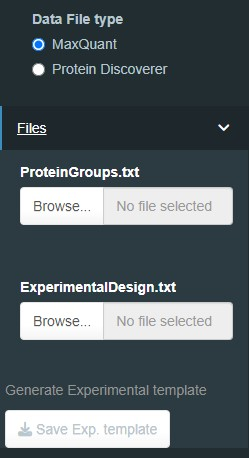
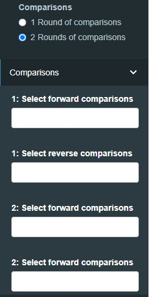
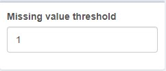
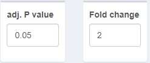
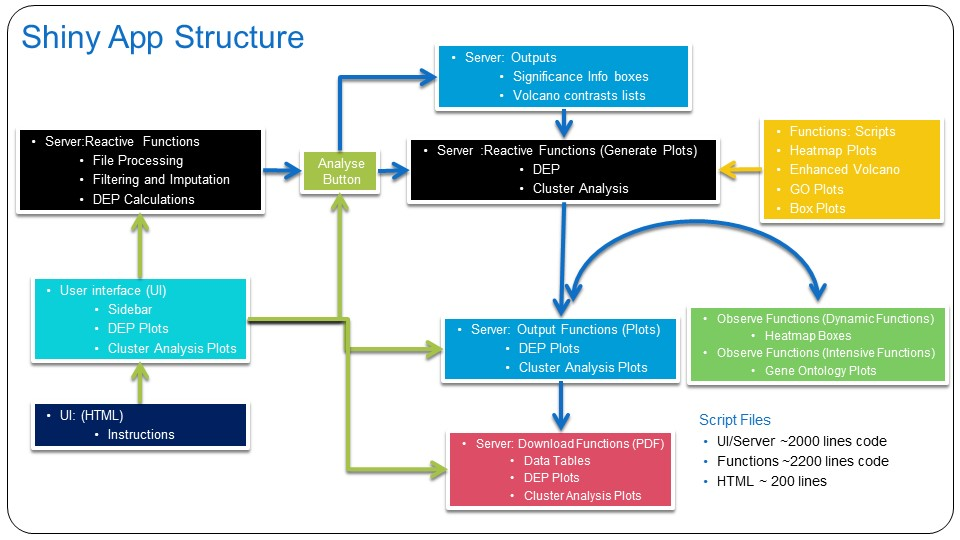

# Description
Manchester Proteome Profiler is an app for generating heatmaps, clustering and GO analysis of clusters using the output files from MaxQuant, FragPipe or Proteome Discoverer. BFDR cutoff values can set at the beginning of the script to generate an appropriate length protein list. Alternatively if SAINTexpress analysis is not applicable the protein list can be generated from Significant Protein List generated by LFQ_Analyst. 

## Table of Contents
- [Files Needed](#files-needed)
- [Instructions](#Quick-Instructions)
  * [Using SAINTexpress results](#using-saintexpress-results)
  * [Using LFQ_Analysist list](#using-lfq-analysist-list)
- [Table of Contents (Optional)](#table-of-contents--optional-)

Quick Instructions
==================

Sidebar Menu
------------

### Choose data type

You can load either the proteinGroups.txt out put from MaxQuant or the Abundance data from Proteome Discovery

### Load Data

Use the browse button to upload data file, the input box will change depending on the Data File selected

### Load Experimental Design template

The experiemtal template matches the column titles from your data file to the sample conditions of your data. It consists of three columns (label, condition and replicate). The label must match the coloumn titles, the condition can be any (short) desciption (use only \_ or . special characters). Replicate column just contains a replicate number.

### Generate Experimental template

A template for the experiemntal design file can be generated using thid button. This will have the label column automatically filled in from the data file.

### Choose Comparisons

The app can process either one set of comparisons or two sets of comparisons.

The comparisons choices are generated automatically from the condition column, and are in both orientations. Eg. Cond.A\_vs\_Cond.B will be found i the forward comparisons list and Cond.B\_vs\_Cond.A will be found in the reverse comparisons list. Multiple comparisons can be selected from either drop down box, and then they are combined to give the total comparison list.

### Second round of comparisons

If the "2 Rounds of comparisons" is selected a further set of two drop boxes will appear. This allows two independant comparisons with different cut-off values, to be analysed, which are then combined to generate a protein list that common to both.

The 2nd round comparisons are chosen in the same manner as the 1st.

### Start Analysis

After the comparisons have been selected press the "Analyse" button to begin the calculations.

-------------------------------------------------------------------------------------------------------------------------------------------------------------------------------------------------------------------------------------------------------------------------------------------------------------------------------------------------------------------------------------------------------------------------------------------------------------------------------------------------------------------------------------------------------------------------------------------------------------------------------------------------------------------------------------------------------------------------------------------------------------------------------------------------------------------------------------------------------------------------------------------------------------------------------------------------------------------------------------------------------------------------------------------------------------------------------------------------------------------------------------------------------------------------------------------------------------------------------------------------------------------------------------------------------------------------------------------------------------------------------------------------------------------------------------------------------------------------------------------------------------------------------------------------------------------------------------------------------------------------------------------------------------------------------------------------------------------------------------------------------------------------------------------------------------------------------------------------------------------------------------------------

Main Dashboard
--------------

### Missing Values

Filters out proteins that contain to many missing values. A value of 1 = protein identified in all or all but one replicate for at least one condtion. Value of 0 (most stringent) protein identified in all replicates for atleast one condition.

### Set Fold-change and p-adj. cut off values

Fold-change cut off values will be converted to log2Fold-Change. For an identified protein to be included in the significant list the fold change must be >= the the chosen value in one of the chosen comparisons.

p-adj vale cut-off. For an identified protein to be included in the significant list the p-adj value must be <= the chosen value in one of the chosen comparisons.

Fold-change and p-adj values for the 2 round of comparisons can be spefified in the second set of boxes

------------------------------------------------------------------------------------------------------------------------------------------------------------------------------------------------------------------------------------------------------------------------------------------------------------------------------------------------------------------------------------------------------------------------------------------------------------------------------------------------------------------------------------------------------------------------------------------------------------------------------------------------------------------------------------------------------------------------------------------------------------------------------------------------------------------------------------------------------------------------

DEP Tab
-------

Cluster Analysis
----------------

## Code Stucture

Provide instructions and examples for use. Include screenshots as needed.

Organisition map of shiny app

## Credits

List your collaborators, if any, with links to their GitHub profiles.

If you used any third-party assets that require attribution, list the creators with links to their primary web presence in this section.

If you followed tutorials, include links to those here as well.

## License

The last section of a high-quality README file is the license. This lets other developers know what they can and cannot do with your project. If you need help choosing a license, refer to [https://choosealicense.com/](https://choosealicense.com/).
