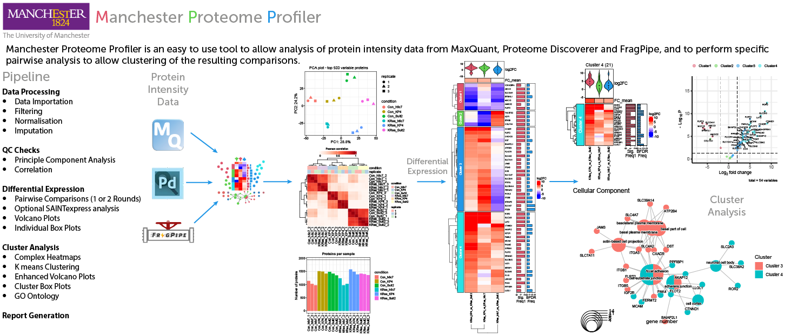
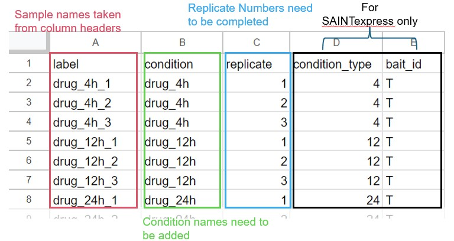

# Manchester Proteome Profiler
Manchester Proteome Profiler is a web application which is easy to use and allows users to upload grouped protein intensity data from MaxQuant, FragPipe or Proteome Discoverer. Following filtering, normalisation and imputation of missing values, Manchester Proteome Profiler uses a number of R packages to perform cluster analysis to allow data visualization and discovery of significantly enriched proteins. The suite also performs correlation and Principal Component Analysis (PCA) on the sample runs to evaluate replicate quality. Complex Heatmaps can be interactively generated from chosen condition comparisons, fold change and p.adj values. K means clustering allows proteins of similar fold change values to be grouped and subjected to GO ontology enrichment analysis. Enhanced Volcano plots and box plots are also generated to validate possible proteins of interest.  The suite also has built in SAINTexpress analysis, which allows identification proteins that have a higher abundance compared to the control samples.


  

## Table of Contents
1. [Quick Instructions](#quick-instructions)
2. [Instructions](#instructions)
3. [Installation](#installation)


# Quick Instructions
#### 1. Load data (Pick Data File type first)
#### 2. Save Exp. Template
#### 3. Modify Exp. Template (Use a spreadsheet editor)
#### 4. Load modified Exp. Template
#### 5. Pick Comparisons or Generate comparison file from Comp. template and upload
#### 6. Press "Analyse"
------------

# Instructions
## Sidebar Menu

### Choose data type
You can load either the proteinGroups.txt output from MaxQuant, the Abundance data from Proteome Discovery, or the combined_protein.tsv (LFQ) or protein group matrix.tsv (DIA) from FragPipe. It is also possible to upload protein intensity data from other sources if it has the format of Gene names as rows and the samples as columns.
### Load Data
Use the browse button to upload data file, the input box will change depending on the Data File type selected. If the "Other (Experimental)" option is selected, upload the data in a tab-separated txt file format. Once the file has been uploaded a further "columns" menu will appear (shown left), use the drop down boxes to select the appropriate columns from the data file. The "Name column" must be the Gene names, but the "ID column", "Description" and "aa length" selections are optional. If any are left empty the app will fill in the missing columns using data from Uniprot (human and mouse data only). Next, select the 1st column containing the intensity data and the last column using the last two drop down boxes. This feature is experimental and will depend on the individual data file whether it is successful. After column selection, generate an "Experimental template" using the "Save Exp. Template" button. 
### Load Experimental Design template
The Experimental template matches the column titles from your data file to the sample conditions of your data. It consists of five columns (label, condition, replicate, condition_type and bait_id). The **label column** must match the column titles, the **condition column** can be any (short) description, **it should not start with a number, e.g. use "drug_4h" not "4h_drug" **(use only _ or . special characters). The **replicate column** just contains a replicate number (see example below). The last two columns are needed for SAINTexpress analysis. SAINTexpress processing allows identification of proteins that were enriched compared with the control samples. The **bait_id column** must contain either "T" for tested samples or "C" for control samples. If are different experimental conditions which have different matching controls, the matching samples for each of the conditions should be labelled in the **condition_type column**. The condition_type can be labelled with any label, e.g. "1", "2" and "3" of "24hr", "48hr" or "72hr". **If SAINTexpress analysis is not needed these columns can be left unaltered**

### Generate Experimental template
To simplify the process a template for the experimental design file can be generated using the "Save Exp. Template" button. Upload the data file first, this will then allow the label column to be automatically filled in from the column titles of the intensity columns. The replicate column is also filled in with the last character, (usually the replicate number). The **condition_type** and **bait_id** are also filled in, however the "T" will needed to changed to a "C" for the control samples for SAINTexpress analysis to be performed. If SAINTexpress analysis is not needed, these columns may be left as they are. However the **condition_type** column can also be use to divide the conditions into groups to generate split PCA plots (see below). Use a spreadsheet editor to modify the Exp. Template, make sure you you save it in the same format (tab-separated txt. file).


### Choose Comparisons
The app can process either one set of comparisons, two sets of comparisons or one set of comparisons with SAINTexpress processing. 
The comparisons choices are generated automatically from the condition column of the Experimental Design file and are in both orientations. Eg. Cond.A_vs_Cond.B and Cond.B_vs_Cond.A. Multiple comparisons can be selected from the drop down box.
### Second round of comparisons
If the "2 Rounds of comparisons" is selected a further drop box will appear. This allows two independent comparisons with different cut-off values, to be analysed, which are then  combined to generate a protein list that common to both. The 2nd round comparisons are chosen in the same manner as the 1st. 
### Comparisons File input
If there are a large amount of conditions it is advised to generate a comparison file. This can be generated by downloading the Comp. template. This contains a list of the conditions the are generated from the Exp template, in the 1st column, which can then be copied into the 2nd and 3rd columns for the 1st round of comparisons, or the 4th and 5th columns for the 2nd round comparisons. If SAINTexpress analysis is performed only the 1st round of comparisons will be used. See the image below for guidance.


### Two dataset comparison mode
If the Two Dataset comparison mode toggle is activated, this now allows two separate data files to be loaded. They can be from the same data-type or different (eg. MaxQuant and FragPipe analysis, or FragPipe DDA and DIA data). Each must have is own Experimental Design file, which can be generated from its specific template file. The comparison template file will now have a sixth column containing the list of the conditions from the second Experimental Template, which must be used to generate the conditions for the second round of comparisons (4th and 5th columns). This option can also be used to assess the affect on the significant protein list of different imputation,  normalisation or p.adjust options, by loading the same datafile and experimental template in twice and generating two identical comparison lists (see "Imputation" instructions).  


### Start Analysis
After the comparisons have been selected press the "Analyse" button to begin the calculations.


## Main Dashboard


### Missing Values
Filters out proteins that contain too many missing values. A value of 1 = protein identified in all or all but one replicate for at least one condition. Value of 0 (most stringent) protein identified in all replicates for at least one condition.


### Set Fold-change and p-adj. cut off values
Fold-change cut off values will be converted to log2(Fold Change) values when used to calculate the number of significant proteins. 
For an identified protein to be included in the significant list the pairwise log2Fold-Change value must be >= to log2 of the chosen fold change value and the p.adj value must be 
Fold-change and p-adj values for the 2 round of comparisons or the second dataset can be specified in the second set of boxes  

### Adjusted p values methods
The method used to calculate adjusted p-values (p.adj) can be selected from the sidebar. The default method (**default (DEP)**) using _limma_ and _fdrtool_ packages, while all the other methods use _limma_ only. Trying other methods can be particularly useful if only a small number of significant proteins are found, which can due to the adjusted p values being adjusted to 1. Check the "Volcano plots" using the **p-adj values** option to see if the plots have been "flattened". The choices are:
**default (DEP)** Uses the _fdrtool_ package for estimating the tail area-based false discovery rate (Fdr)
**Benjamini-Hochberg (BH)** Also known as "False Discovery Rate (FDR)" adjustment, aiming to control the expected proportion of false discoveries among the rejected hypotheses.
**Benjamini-Yekutieli (BY)** Another FDR controlling method, more robust under dependent test conditions.
**Bonferroni** A conservative method, multiplying p-values by the number of comparisons.
**Hochberg** A step-up method, slightly more powerful than Bonferroni, suitable for independent or positively correlated hypotheses.
**Hommel** A sequentially rejective Bonferroni adjustment that is slightly less conservative.


### Set BFDR Cut-off and BFDR_Freq (SAINTexpress only)
SAINTexpress analysis assigns a Bayesian False Discovery Rate (BFDR) value for every protein detected for each sample condition based on the replicate values. To generate a list of proteins a BFDR cut-off value is selected, (the default is 0.05 or 5%). If a protein has a BFDR 


### Report Generation
Detailed reports which contain a description of the analysis methods used, the selected cut-off values, significant protein numbers and the generated plots can be downloaded as a single PDF file. There are three lengths of reports. The short report contains the correlation plots, the QC plots, complex heatmaps, all cluster heatmaps, and all the enhanced volcano plots. This can can be generated relatively quickly and is useful for checking if the correct cluster number has been selected and the heatmaps have the correct saturation levels. If one of the heatmap clusters contains only a single protein, an error message will be displayed. A different cluster number must be selected before the report can be generated.
To add all the possible cluster box plots for both the non-imputed and imputed data. The "with Box Plots" should be selected
If the "long" report is selected, all the GO-ontology plots will be generated, which can take several minutes, **the correct option must be selected from the "GO species" radio buttons in the top right corner of app**. The plots can then be inspected, by pressing the analyse button on the specific tab e.g. "Molecular Function". The GO level displayed can then be altered to choice. The long report can then be downloaded by pressing the "Download Report" button as before.  


## DEP Tab  
### Result Plots


### Selected Protein
This shows box plots for proteins that are selected in the "Top Table" on the left hand side, gene names can be searched either from the final significant protein list, or the total protein list (if "Show all proteins" is selected). The plots can be displayed in 4 types. Each plot can be downloaded as a pdf using the "Save plot" button, and can be resized using the "PDF Width" and "PDF Height" inputs below.
**contrast: **Shows the log2(Fold Change) values for the selected comparisons (needs more than one comparison).
**centrered: **Shows the log2 centered intensities (after imputation) for each of the samples, indicating replicates
**normalised:**Shows the log2 intensities for each of the proteins after normalisation for each of the samples, indicating replicates
**imputed: **Shows the log2 intensities for each of the proteins after normalisation and imputation for each of the samples, indicating replicates


### Abundance Heatmap
This shows a heatmap of the log2 Intensity values of the most abundant proteins as ranked by their average log2 intensity over all the samples. The number of most abundant proteins can be changed using the input box, and the values can be switched from _imputed_ to _normalised_ values. Normalised values will contain missing values indicated by grey boxes. The heatmap can also be switched to show just the proteins from the significant protein list. The top annotation shows a violin plot indicating the log2 intensity values for each sample, for the proteins shown. The right annotation shown the mean intensity value for each protein, if normalised values are chosen the missing values are excluded from mean calculation.  The plot can be downloaded using the "Save heatmap" button. It can be can be resized using the "PDF Width" and "PDF Height" inputs. Below the the heatmap is a table containing the heatmap values along with information on the protein name and accession ID. This can be downloaded using the "Save Abundance Table" button. If a second dataset is loaded a second Abundance Heatmap will be available. 


### Volcano Plot
A standard Volcano plot can be displayed for each of the comparisons, which are selected using the Contrast drop box. This contains points for all the filtered proteins, with the significant proteins indicated, that pass either fold change or p value cut-offs, or both. There are three different types of plots:
**p-adj sig.** This plots the p-values against log2(Fold Change) values and labels the proteins from the significant protein list which by default uses p.adj values.
**p-Val sig.** This plots the p-values against log2(Fold Change) values and labels the proteins that pass the p.val and log2(Fold Change) values are labelled  (Recommended if "Use p.Val" is selected).
**p-adj values** This plots the p. adj values against log2(Fold Change) values and labels proteins from the significant protein list This plot is a better representation of the data if the default option of using p.adj values is used.
Only selected proteins of interest can be shown by choosing from the "Top Table" on the left hand side, gene names can be searched either from the final significant protein list, or the total protein list (if "Show all proteins" is selected). Text size in the app can be changed using the "Font size" input.  If two rounds of comparisons or a second dataset is used, the plots are shown for the second set of comparisons in a separate tab. All volcano plots can be saved as pdf files and resized using the "PDF Width" and "PDF Height" inputs below the plot.

### Significance Count Plot
The Significance Count Plot shows the number of significant proteins for each fold change value up to the "Maxiumum Cut-of value" chosen in the box above. For an identified protein to be included in the significant list the pairwise log2Fold-Change value must be >= to log2 of the tested fold change value and the p.adj value must be 


### Correlation Plots


### PCA
The Principle Component Analysis plot shows similarities between groups of samples in a data set. Each point on a PCA plot represents a correlation between an initial variable and the first and second principal components. Ideally the points should be grouped together for each of the conditions (as shown), rather than grouped by replicate, or grouped randomly. The plot can be saved as a pdf file and resized using the "PDF Width" and "PDF Height" inputs. The values used to generate the plot can also be downloaded for plotting in another application using the "Save Values" button. If two datasets are loaded a second PCA plot will be available.  It is also possible to split the PCA plots into groups, groups can be assigned in the ExperimentalTemplate.txt file using the "condition_type" column. By default the plots show the Principle Component values with the most variation (PC1 and PC2), other Principle Component values can be plotted on the X or Y axis using the numeric value boxes above the plot.  To see what percentage of the total variance the other components have, use the "PCA Scree Plot" in the adjacent tab.


### Correlation
The correlation tab shows heatmap showing the Pearson correlations between the different samples, using ratio data from the chosen comparisons. Ideally the sample replicates should be grouped together for each condition. If the plot is uniformly coloured over the entire plot this indicated there is only small differences between the samples. If two rounds of comparisons are chosen a second correlation plot is shown in a separate tab, based on the ratios from the second set of comparisons. The plots can be saved as a pdf files and resized using the "PDF Width" and "PDF Height" inputs. If two datasets are loaded a second Correlation plot will be available.


### Frequency Plot
The frequency tab shows a histogram showing proteins that are differentially enriched/expressed in multiple comparisons. It indicates the distribution of significant conditions per protein and the overlap between conditions. If two rounds of comparisons are shown a second frequency plot is shown in a separate tab, based on the significant proteins from the second set of comparisons. The plots can be saved as a pdf files and resized using the "PDF Width" and "PDF Height" inputs.


### QC Plots


### Protein Numbers
This plot shows the number of identified proteins per sample after filtering. Filtering can be controlled using the "Missing value threshold" as described earlier. 


### Normalisation
The data is background corrected and normalised by variance stabilizing transformation (vsn). The distribution of the protein intensities is indicated for each sample before and after normalisation. The normalisation method can be switched to quantile normalisation using the radio button on the "Normalisation options" drop down menu on the sidebar. Comparisons between the normalisation methods can be investigated using the two dataset comparison method described in the imputation section below.


### Imputation
The imputation plot shows the effect on the protein intensities of imputation of missing values. The default method ("man") imputes missing values using random draws from a manually defined left-shifted Gaussian distribution centred around a minimal value (used for missing not at random data (MNAR)). This results in a peak  appearing on the left side of the intensity distribution on the lower plot. This peak can be adjusted to be closer or further away from the main distribution using the "Left-shifted Gaussian distribution" input box on the "Imputation options" section of the sidebar. Other imputation options can also be selected using the radio buttons. Usually the default settings are sufficient, if different imputation setting are needed, more detailed information on the other imputation options can be found by clicking on the "Detailed information link".
**Imputation Analysis Tools** 
As some of the imputation methods use a degree of randomisation in the calculation process (man, QRILC, MinProb), this can lead to some proteins having a greater fold-change between comparisons, due to artefacts of the randomly assigned missing values. This is especially true if the fold change cut-off value is low. To overcome this problem it is possible to impute the missing values with 3 different random seeds, and then use the average imputed value. The original non-missing values will be unchanged. To use the averaged value select the "Average Imputation of 3 different random seeds (1st Dataset)" box in the "Imputation options" menu. Another option is to use methods not affected by random seed values such as Nearest neighbour averaging (knn) or Bayesian missing value imputation (bpca). 
**Two dataset comparison method** 
To study the effect of random assigned imputation values or different imputation methods on the significant protein list, it is possible to use the "Two Dataset comparison mode". Load in the same data file and experimental template for both "Data file types", then generate a comparison file with identical comparisons (columns B and C should match columns D and E), and upload the file. Set identical "adj. P value" and "Fold change" values for both datasets and press "Analyse". This should generate two identical significant protein lists. You can then either select the "Average Imputation of 3 different random seeds (1st Dataset)" box or the "Use different imputation seed on second dataset" box to assess the effect of using the different imputation options. It is also possible to select different imputation methods for each dataset using the "Imputation type" selection buttons. Use the "Comparison Heatmaps" tab in the "Cluster Analysis" section to see the differences in the significant protein lists generated.

### Sample Coverage, Missing values-Quant and Missing Values - Heatmap plots
For a detailed description of the other QC plots, a detailed explanation can be found at the ["Introduction to DEP"](https://bioconductor.riken.jp/packages/3.8/bioc/vignettes/DEP/inst/doc/DEP.html) web pages. 


## Cluster Analysis Tab  


### Complex Heatmap
The Complex Heatmap is generated from either the Significant Proteins from the 1st Round of comparisons (COMP1), or either the overlapping proteins from the 1st and 2nd rounds of comparisons (2 Rounds of Comparisons) or the overlapping proteins from the SAINTexpress analysis and the 1st round of comparisons. The title pain above the heatmap will indicate which option has been chosen, along with the fold change and p.adj/p.val cut-off values chosen. If SAINTexpress analysis is used the BFDR Cut-off and BFDR Freq values are indicated. 
**Top Annotation** Violin plots indicate the range and distribution of the log2 values for each of the comparisons. The FC_means shows the colour and intensity of the mean of the log2 values for each comparison. 
**Right Annotation** Gene names are indicated on the right hand side along with  histograms indicating the number of times that protein has passed the significance cut-off values (FC and p.adj/p.val) This will range from 1 up to the number of pairwise comparisons chosen. If 2 rounds of comparisons are chosen there will be a histogram for each set of comparisons. If SAINTexpress analysis is chosen the histograms will indicate the pairwise comparison frequency and the number of times the protein has passed the SAINTexpress cut-off values (BFDR and BFDR_Freq). 
**Left Annotation** The colour of the Cluster boxes can be changed with the "Choose palette" selector box. The colour of the cluster boxes is replicated in the Enhanced Volcano Plots.
**Kmeans cluster** The number of Kmeans clustered can be altered using the input box above, up to a maximum of 6 clusters. The number of clusters needed is best assessed by observing the block patterns generated by the data. You can also choose whether to perform hierarchical clustering on the comparisons using the "Cluster columns" toggle. If a specific ordering of the comparisons is wanted, this can be controlled by the order of the comparisons in the comparisons file.
**Heatmap customisation** The high and low colours can be changed using the "High Colour" and "Low Colour" input boxes. The intensity of the log2 values in the heatmap can be altered using the "Colour Limit (log2)" input box. This can be using if the heatmap is either under or over saturated. Finally a range of palettes is available, which will give different colours. The intensities of the colours can be reduced using the "Alpha" input box. (Values between 0 and 10).
The complex heatmap can be saved as a pdf file and resized using the adjacent "PDF Width" and "PDF Height" inputs.


### Cluster Heatmap
Each individual cluster can be rendered as a heatmap by selecting the "Cluster" tab on the right hand side. The cluster heatmap to be displayed can be selected using the "Cluster No." input box. The resulting heatmap is rendered with a top annotation using fold change data from the protein displayed in that cluster only. The colour scheme of the heatmap will match the initial complex heatmap.  
The cluster heatmap can be saved as a pdf file and resized using the adjacent "PDF Width" and "PDF Height" inputs. 
**Cluster table** The Gene symbol name, protein name and Uniprot ID for each of the protein in the chosen cluster is displayed at the right hand side of the cluster heatmap. This can be downloaded using the "Save Cluster Table" button.  
A table containing all the significant proteins and the specific cluster they are found can be downloaded using the "Save All Clusters" button. 


### Enhanced Volcano
Enhanced volcano plots can be generated for all the comparisons chosen. By default these plots show the positions on the volcano plot for the significant protein list only. The colour of the points is dependent on the cluster group it belongs to. The colour scheme will also match the palette chosen in the complex heatmap. There are three different types of plots:
**p-adj sig.** This plots the p-values against log2(Fold Change) values and labels the proteins from the significant protein list which by default uses p.adj values. 
**p-Val sig.** This plots the p-values against log2(Fold Change) values and labels the proteins that pass the p.val and log2(Fold Change) values are labelled (Recommended if "Use p.Val" is selected).
**p-adj values** This plots the p. adj values against log2(Fold Change) values and labels proteins from the significant protein list This plot is a better representation of the data if the default option of using p.adj values is used.
The enhanced volcano plots can be further customised to show the names of selected proteins only using the "Selected Names only " check box. You can search for the required names from the significant protein list in the table below, it is also possible to search by cluster number, use shift+click to select multiple entries. To show the data points for all the proteins uncheck the "Significant proteins only" check box, the non-significant proteins will be indicated in grey. The customised options selected in the left hand volcano plot will be carried over to the report, to allow easier generation of multiple plots.
The enhanced volcano plot can be saved as a pdf file and resized using the adjacent "PDF Width" and "PDF Height" inputs.


### Box plots
Box plots showing the log2 intensity values for each condition for all the proteins from chosen cluster are shown. The intensity values can be switched between imputed values or normalised only values, and the chosen cluster number can be changed. These plots can be used to asses the effect of imputation on the data and to identify which values were missing. It can also be used to evaluate the quality of each the replicates to observe if any set of replicates were consistent outliers.
The box plots can be saved as a pdf file and resized using the adjacent "PDF Width" and "PDF Height" inputs.


### Gene Ontology plots
The Gene Ontology plots are generated from the proteins listed in each cluster of the complex Heatmap, and uses the clusterProfiler package. Each cluster is used to calculate enriched functional profiles using enrichGO, which are then aggregated to generate a single plot. All three GO domains can be tested, "Molecular Function", "Cellular Component" and "Biological Process" and the enrichment results are displayed as a "Dot plot" and a "Network plot". The "GO level" input box can be used to show either more global GO terms (lower number) or more granular GO terms (higher number). Before generating the Gene Ontology plots, the correct option must be selected from the "GO species" radio buttons in the top right corner of app. 
Both plots can be saved as a pdf file and resized using the adjacent "PDF Width" and "PDF Height" inputs and a table of Go enrichment result data can be downloaded.

## Installation
Once all the prerequisites are installed, follow steps below to build and run the server locally.

You can build it natively:

``` sh
# Clone the repository
git clone https://github.com/StuCain/Manchester_Proteome_Profiler

# Move to the folder
cd Manchester_Proteome_Profiler

# Inside R console or R studio
> install.packages("renv")
> install.packages("BiocManager")
> renv::install("shiny")
> renv::install("shinydashboard")
> renv::install("shinyWidgets")
> renv::install("tidyverse")
> renv::install("circlize")
> renv::install("data.table")
> renv::install("scales")
> renv::install("gridtext")
> renv::install("waiter")
> renv::install("shinythemes")
> renv::install("RColorBrewer")
> renv::install("readxl")
> renv::install("rmarkdown")
> renv::install("tinytex")
> renv::install("bioc::DEP")
> renv::install("bioc::SummarizedExperiment")
> renv::install("bioc::ComplexHeatmap")
> renv::install("bioc::clusterProfiler")
> renv::install("bioc::enrichplot")
> renv::install("bioc::QFeatures")
> renv::install("bioc::EnhancedVolcano")
> renv::install("bioc::HDO.db")
> renv::install("bioc::org.Hs.eg.db")
> renv::install("bioc::org.Mm.eg.db")
> renv::install("bioc::VennDetail")

# Execute
> library("shiny")
> runApp()
```

Or run it through Docker:

``` sh
# Clone the repository
git clone https://github.com/StuCain/Manchester_Proteome_Profiler
# Move to the folder
cd Manchester_Proteome_Profiler

# Build Manchester_Proteome_Profiler (Any name after -t)
docker buildx build -f Dockerfile.local -t Manchester_Proteome_Profiler  --output=type=docker --platform=linux/amd64 .

# Run FragPipe-Analyst
docker run -it --platform=linux/amd64 -d -p 80:80 Manchester_Proteome_Profiler

# Open local interface
http://localhost:80/fragpipe-analyst/
```
