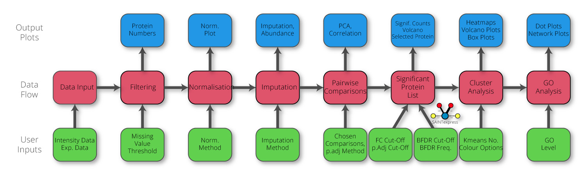

# Manchester Proteome Profiler
Manchester Proteome Profiler (MPP) is an open-source R Shiny application that streamlines downstream analysis of quantitative proteomics data. Compatible with grouped protein intensities tables from MaxQuant, FragPipe, Proteome Discoverer, or other custom layouts, MPP provides an integrated platform for filtering, normalization, imputation, differential expression analysis, and cluster analysis across user chosen experimental conditions. It supports both single- and dual-dataset comparisons, incorporates SAINTexpress for affinity purification and BioID experiments, and downstream analysis of the significant protein list clusters to functional enrichment and interaction networks via Gene Ontology, BioGRID, and STRING. 


  
## Why MPP?

Unlike many proteomics analysis tools, MPP:

- Supports MaxQuant, FragPipe, Proteome Discoverer and custom formats
- Allows dual-dataset comparison workflows
- Integrates SAINTexpress analysis
- Combines clustering, GO enrichment and interaction network analysis
- Generates publication-ready reports
- Requires no R programming knowledge

## Features
- Supports single and dual dataset comparisons
- Normalisation and imputation options
- Differential expression analysis using limma
- SAINTexpress support for AP-MS/BioID data
- Gene Ontology enrichment and protein interaction networks (BioGRID, STRING)
- Interactive visualisations: PCA, volcano plots, heatmaps, violin plots
- Publication-ready plots and downloadable reports

## Table of Contents
1. [Quick Instructions](#quick-instructions)
2. [Installation](#installation)


# Quick Instructions
#### 1. Load data (Pick Data File type first)
#### 2. Save Exp. Template
#### 3. Modify Exp. Template (Use a spreadsheet editor)
#### 4. Load modified Exp. Template
#### 5. Pick Comparisons or Generate comparison file from Comp. template and upload
#### 6. Press "Analyse"

------------
## Public Server
There is currently a public server hosted by the University of Manchester available at https://mpp.sbs.manchester.ac.uk/ where more detailed instructions can also be found.

## Input Requirements
- Grouped protein intensity files (e.g., `proteinGroups.txt`, `combined_protein.tsv`)
- Experimental design file (template provided in-app)
- Optional: comparison file for complex queries

## Data Pipeline


## Citation

If you use Manchester Proteome Profiler in your research, please cite:

> Cain, S.A., Fatima, M. & Humphries, M.J. *Manchester Proteome Profiler: A User-Friendly Platform for Quantitative Proteomic Analysis*. Journal of Proteome Research (2026).

DOI: 10.1021/acs.jproteome.5c01140


## Installation
Once all the prerequisites are installed, follow steps below to build and run the server locally.

You can build it natively using the following code or use the renv_MPP script:

``` sh
# Clone the repository
git clone https://github.com/StuCain/Manchester_Proteome_Profiler

# Move to the folder
cd Manchester_Proteome_Profiler

# Install renv and BiocManager from CRAN
if (!requireNamespace("renv", quietly = TRUE)) install.packages("renv")
if (!requireNamespace("BiocManager", quietly = TRUE)) install.packages("BiocManager")

# Initialize renv project (creates renv.lock and renv library folder)
renv::init(bare = TRUE)

# Install CRAN packages using renv
cran_pkgs <- c(
  # Core development and utilities
  "devtools", "assertthat", "fdrtool",

  # Shiny framework & UI
  "shiny", "shinydashboard", "shinyWidgets", "shinythemes",
  "shinyalert", "shinyjs", "shinyBS", "shinycssloaders",
  "waiter", "DT",

  # Data handling and plotting
  "tidyverse", "data.table", "scales", "RColorBrewer",
  "readxl", "rmarkdown", "svglite", "gridtext", "ggrepel",
  "circlize", "httr", "rjson", "mvtnorm", "tmvtnorm", "ggtangle",
  "tidygraph", "ggraph",

  # Asynchronous and performance tools
  "promises", "future",

  # Reporting and LaTeX
  "tinytex"
)

renv::install(cran_pkgs)

# Install Bioconductor packages using renv
bioc_pkgs <- c(
  "DEP", "ComplexHeatmap", "clusterProfiler", "QFeatures",
  "EnhancedVolcano", "HDO.db", "org.Hs.eg.db", "org.Mm.eg.db",
  "VennDetail", "STRINGdb",
  "org.At.tair.db", "org.Xl.eg.db"
)
for (pkg in bioc_pkgs) renv::install(paste0("bioc::", pkg))

# Install GitHub Packages packages using renv
if (!requireNamespace("devtools", quietly = TRUE)) renv::install("devtools")
renv::install("npjc/biogridr")
renv::install("guokai8/VennDetail")


# ---- Snapshot the environment ----
# This records exact package versions into renv.lock
renv::snapshot()

# ---- Optional: TinyTeX setup ----
# Ensures LaTeX-based PDF reporting works as in Docker
if (!tinytex::is_tinytex()) {
  tinytex::install_tinytex(force = TRUE)
  system("tlmgr install sourcesanspro ly1 bookmark")
}
# Execute
library("shiny")
shiny::runApp("app/app.R")
```

Or build a Docker image

``` sh
# Clone the repository
git clone https://github.com/StuCain/Manchester_Proteome_Profiler
# Move to the folder
cd Manchester_Proteome_Profiler

# Build Manchester_Proteome_Profiler (Any name after -t)
docker buildx build -f Dockerfile -t manchester_proteome_profiler  --output=type=docker --platform=linux/amd64 .

# Run Manchester Proteome Profiler
docker run -it --platform=linux/amd64 -d -p 3838:3838 manchester_proteome_profiler

# Open local interface
http://localhost:3838/
```

The Manchester Proteome Profiler (MPP) Docker image is available on Docker Hub.
To download (pull) the latest version:

``` sh
# Pull the repository
docker pull stucain/mpp

# Run Manchester Proteome Profiler
docker run -d -p 3838:3838 stucain/mpp

# Open local interface
http://localhost:3838/
```


## 🔑 BioGRID API Key Setup

Some features in Manchester Proteome Profiler (e.g. BioGRID interaction networks) require a free BioGRID REST API key.

### 1. Generate a BioGRID API key
- Visit: https://thebiogrid.org/  
- Navigate to **Tools → Web Services**   
- Generate an API key  

---

### 2. Add your API key locally

Create a file called `.Renviron` in the app directory (same folder as `app.R`) and add:

``` sh
BIOGRID_KEY=your_api_key_here
```
Restart your R session after adding this file.

---

### 3. Running the app

The application will automatically detect the key using environment variables.

If no key is detected:
- BioGRID-dependent features will be unavailable  
- Core analysis functionality remains unaffected  

---

### 4. Docker usage

If running via Docker, pass the key using an environment file
Run the Docker command in the same location as the .Renviron file or include path:

``` sh
docker run -p 3838:3838 --env-file .Renviron stucain/mpp
```

## License
This project is licensed under the GNU General Public License v3.0 - see the LICENSE file for details.
